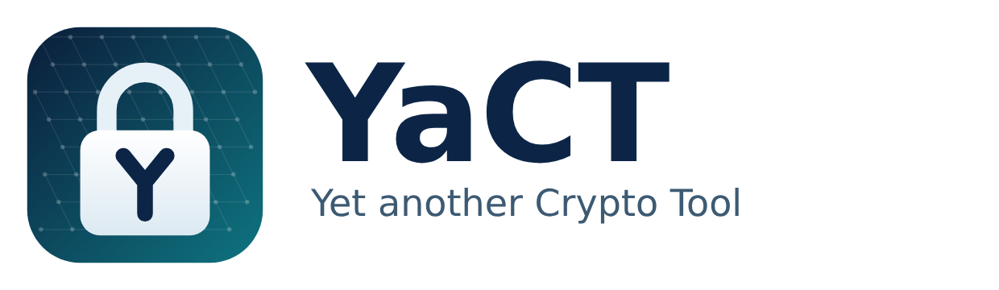

<p align="center">
  <picture>
    <source media="(prefers-color-scheme: dark)" srcset="docs/logo/yact-wordmark-dark.png">
    
  </picture>
</p>

# YaCT – Yet another Crypto Tool

YaCT is an encrypted file vault for the desktop. A vault ("container") is a
single file of fixed size that holds your files encrypted. You open it with a
password or with a **post-quantum key pair**, add and extract files, and close
it again.

> **Status:** version 1.0 in development. The cryptography follows current
> standards and is thoroughly tested, but it has **not been reviewed by
> independent security experts**. Do not rely on YaCT as your only protection
> for critical data until it has been. See [SECURITY.md](SECURITY.md).

## Features

- **Strong encryption:** AES-256-GCM (default) or ChaCha20-Poly1305; every
  64 KiB block is authenticated, so tampering and damage are detected.
- **Passwords:** Argon2id (64 MiB, or 256 MiB in the "strong" profile).
- **Post-quantum keys:** share a container with someone's public key.
  ML-KEM-1024 (FIPS 203) combined with X25519: an attacker has to break both.
- **Several ways in:** a container can have up to 16 entries – passwords and
  public keys – each of which opens it.
- **Fixed size, no leaks:** free space is filled with random data, so the
  file does not reveal how much it holds. Containers can be enlarged.
- **Deleting means deleting:** deleted files are overwritten with random data
  (can be switched off).
- **Crash-safe:** a crash or power cut leaves the container in its previous or
  its new state, never broken.
- **Languages:** German, English (British), French, Spanish, Portuguese.

## Getting YaCT

**Ready-made builds** for Linux, Windows and macOS are attached as artifacts to
every run of the [build workflow](.github/workflows/build.yml) (GitHub, tab
*Actions*). They contain their own Java runtime; nothing else needs to be
installed. The builds are not signed, so Windows SmartScreen and macOS
Gatekeeper will warn on first start.

**From source:** see [Building](#building).

## Using YaCT

1. **Create a container:** *Create new container…*, choose where to save it,
   its size and a password (or a public key). The container is filled with
   random data, which takes a moment for large sizes.
2. **Add files:** drag files or folders into the window, or use *Add files…*
   and *Add folder…*. Select a folder first to add into it.
3. **Get files out:** select files or folders and choose *Extract…*.
4. **Share a container:** the other person creates a key pair (*Keys → New
   key pair…*) and sends you the `.yactpub` file. In *Access…* choose *Add
   key…* and compare the fingerprint with them by phone or in person.
5. **Close** the container (*File → Close container*) when you are done; this
   also happens when you quit.

Keep your private key file (`.yactkey`) and passwords safe: **without them,
nobody can open the container – including you.** There is no recovery.

## Security in brief

YaCT protects your files against anyone who gets hold of the container file
but not a password or key: a lost laptop, a stolen USB stick, a cloud
provider. It cannot protect against malware on the computer while the
container is open, against weak passwords, or against copies of the container
kept elsewhere (backups, cloud versions). Details: [SECURITY.md](SECURITY.md);
the file format: [docs/container-format.md](docs/container-format.md).

## Building

Requirements: JDK 21 or newer, Maven 3.9 or newer.

```sh
mvn verify                       # build and run all tests
mvn -q install -DskipTests       # build only
mvn -q -pl yact-ui javafx:run    # start the application
```

The build also produces a runnable jar with its libraries in `lib/`:

```sh
java -jar yact-ui/target/yact-ui-1.0.0-SNAPSHOT.jar
```

### Self-contained application

`jpackage` (part of the JDK) builds an application with its own Java runtime,
for the operating system it runs on:

```sh
packaging/package.sh             # Linux, macOS: app image in target/dist/
packaging/package.sh deb         # Linux installer (needs dpkg-deb and fakeroot)
packaging/package.sh dmg         # macOS installer
powershell -File packaging\package.ps1            # Windows app image
powershell -File packaging\package.ps1 -Type msi  # Windows installer (needs WiX)
```

Installers register `.yact` files, so a double-click opens them in YaCT.

### Checks

```sh
target/dist/YaCT/bin/YaCT --self-test   # crypto and locale data of a packaged build
```

*Help → Crypto self-test* shows the same in the application.

Screenshots of every screen, rendered on a virtual display (also runs an
import through the UI end to end):

```sh
mvn -q install -DskipTests
LC_ALL=C.UTF-8 xvfb-run mvn -pl yact-ui test -Dtest=UiScreenshots \
    -Dyact.screenshots=/tmp/yact-shots -Dyact.locale=de -Dsurefire.failIfNoSpecifiedTests=false
```

## Project structure

| Path | Contents |
|---|---|
| `yact-core` | Cryptography and container engine, no UI (BouncyCastle) |
| `yact-ui` | JavaFX desktop application |
| `docs/container-format.md` | Specification of the file formats |
| `packaging/` | Scripts for self-contained builds and installers, application icons |
| `docs/logo/` | Logo sources (SVG) and renderings |

AES-256-GCM uses the JDK's implementation, which uses the processor's AES
instructions; all other algorithms come from BouncyCastle. YaCT implements no
cryptographic algorithm itself.

## Licence

MIT, see [Licence.txt](Licence.txt).
